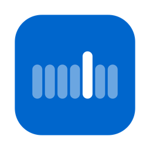

<p align="center"></p>

<h1 align="center">Planner</h1>
<p align="center">Your whole week on your Mac's desktop.<br>Free forever · Created by Victor Tognollo</p>

---

Planner is a weekly planner that lives on your Mac's desktop, behind your windows, like a widget. The week runs Sunday to Saturday, and it opens by itself when your Mac starts. Available in English and Portuguese.

## Features

- **Three kinds of items on any day:** tasks (crossed out when done), meetings with a "Join" link, and reminders with a time.
- **Alerts:** a notification at reminder time, 5 minutes before each meeting, and when the focus timer ends.
- **Synced calendars:** shows live events from your Mac's Calendar (iCloud, Google, Outlook, and .ics links from any website).
- **Focus timer:** 15, 25, 45, 60 or any number of minutes. Focused time is added up per day.
- **Weekly priorities, progress and daily habits** that you can customize.
- **Two layouts:** horizontal (days in columns) or vertical (days in rows). Resize the window and everything scales down together, nothing gets cut off.
- **Minimal, Apple-style design** with light and dark mode.
- **English or Portuguese:** follows your Mac's language, or pick one under ⋯ › Language.
- **Private:** your tasks are stored only on your Mac. No account, no cloud, no data collection.

## Download and install

1. Download **Planner.zip** from the [Releases](../../releases/latest) page.
2. Unzip it and drag **Planner.app** to your Applications folder.
3. Open Planner. The first time, macOS warns that it can't verify the app (it doesn't come from the App Store). Allow it under **System Settings › Privacy & Security › Open Anyway**.

The illustrated step-by-step guide, **Installation Guide.pdf**, is inside the zip.

**Requirements:** macOS 14 (Sonoma) or later, Mac with Apple silicon or Intel.

## Build from source

Requires Xcode (or the Command Line Tools).

```bash
./build.sh            # builds build/Planner.app
./build.sh --install  # builds, installs to /Applications and opens it
./build.sh --package  # builds build/Planner.zip with the app, PDF guides, README and LICENSE
```

`--package` uses Google Chrome to turn `docs/guide.html` and `docs/guia.html` into PDFs.

### Project layout

| File | What's inside |
| --- | --- |
| `Sources/App.swift` | Window, layouts, position on screen, launch at login |
| `Sources/Views.swift` | The whole interface (SwiftUI) |
| `Sources/Model.swift` | Data, dates and local storage |
| `Sources/Calendars.swift` | Sync with the Mac's Calendar |
| `Sources/Notifier.swift` | Notifications |
| `Sources/FocusTimer.swift` | Focus timer |
| `Sources/Localization.swift` | English and Portuguese text |
| `docs/guide.html`, `docs/guia.html` | Installation guides (become PDFs) |

## License

Free forever. You can use, copy, share and modify Planner at no cost. Selling the app or modified versions is not allowed. When sharing, keep the creator's name. Full text in [LICENSE.txt](LICENSE.txt).

Created by **Victor Tognollo**.

---

### Em português

O Planner é um planner semanal gratuito para a mesa do Mac, com tarefas, reuniões, lembretes, agendas sincronizadas e timer de foco. O app funciona em português e inglês (⋯ › Idioma). Baixe o **Planner.zip** em [Releases](../../releases/latest) e siga o **Guia de instalação.pdf** que vem dentro. Licença: gratuito para sempre, pode modificar, não pode vender ([LICENCA.txt](LICENCA.txt)).
